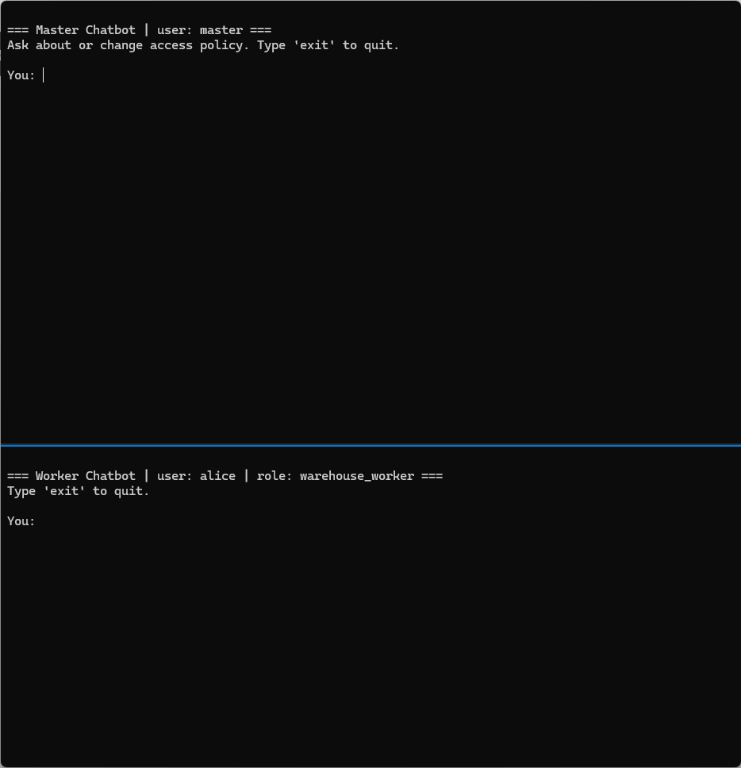

# RBIC Plugin — Role-Gated LLM Chatbot (Casbin RBAC+ABAC over Text-to-SQL)

An enterprise LLM chatbot that answers workers' questions from a company
database while revealing **only what their role permits**.

The LLM translates natural-language questions into SQL, but it is treated as
untrusted: every statement it generates passes through a SQL gate that

1. **parses** it to an AST (`sqlglot`) — single `SELECT` only,
2. **RBAC-checks** every referenced `table.column` against a Casbin policy,
3. **rewrites** it with ABAC row filters bound from the worker's attributes
   (e.g. `WHERE dept = 'engineering'`),

before it ever touches the database. Restricted data never enters the model's
context. Denied requests always get the fixed, code-generated response:

> *"You have no access to this information, please approach your manager."*

```
worker question ──► LLM (text-to-SQL) ──► sql_gate.authorize()
                                              │  parse → RBAC → ABAC → audit
                                              ▼
                                    SQLite (read-only) ──► rows ──► LLM ──► answer
```

---

## Prerequisites

- Python 3.10+
- An Anthropic API key (only needed for the chat loop — the gate demo runs
  without one)

## Installation

```bash
# 1. Clone / copy the project, then from the project root:
python -m venv .venv

# Windows
.venv\Scripts\activate
# macOS / Linux
source .venv/bin/activate

# 2. Install dependencies
pip install -r requirements.txt
```

## Configuration

Create a `.env` file in the project root (never commit it):

```
ANTHROPIC_API_KEY=sk-ant-api03-your-key-here
```

## Running

### 1. Seed the demo database

```bash
python seed_db.py
```

Creates `company.db` (SQLite) with 9 tables and demo rows spanning two
warehouses (`SG-01`, `SG-02`) and two departments (`engineering`,
`logistics`), so you can see the row filtering work.

### 2. Smoke-test the SQL gate (no API key needed)

```bash
python sql_gate.py
```

Runs ~10 allow/deny cases and prints each decision, e.g. `SELECT * FROM
employees` as hr_staff is denied because the star expands to the forbidden
`salary` column.

### 3. Chat as a worker

```bash
python chatbot.py alice     # warehouse_worker, site SG-01
python chatbot.py bob       # hr_staff, dept engineering
python chatbot.py carol     # hr_manager (inherits hr_staff + salary access)
python chatbot.py dave      # finance_analyst, dept logistics
```

Type `exit` to quit.

### Demo users

| User  | Role             | Sees                                                    |
|-------|------------------|---------------------------------------------------------|
| alice | warehouse_worker | inventory / shipments / incidents — **SG-01 rows only** |
| bob   | hr_staff         | employees (no salary), leave, trainings — **engineering only** |
| carol | hr_manager       | everything bob sees **plus salaries**                   |
| dave  | finance_analyst  | budgets, invoices, expenses — **logistics expenses only** |
| master | master          | **no data** — manages policy via `master_bot.py`        |

### Things to try

```
python chatbot.py bob
You: who is on leave this month?          → answers from engineering rows only
You: what is everyone's salary?           → "You have no access to this information, ..."
You: what is my salary?                   → answered from bob's own payroll row only

python chatbot.py carol
You: show me my team's salaries           → self + subordinates (Bob, Erin) only

python chatbot.py alice
You: which SKUs are running low?          → SG-01 stock only; SG-02 is invisible
You: show me the expense reports          → denied (not a warehouse topic)
```

### Policy as code

Access rules evolve by editing `casbin/policy.csv` — no code changes. The
shipped policy encodes a three-stage salary rollout (deny-all → workers see
their own payslip → managers also see subordinates'), and
`test_salary_policy_evolution.py` replays all three stages against the same
codebase:

```bash
pytest -q
```

---

## Managing access (master user)

All policy lives in two files — no code changes needed:

- **`casbin/policy.csv`**
  - `p, <role>, <table.column|table.*>, read` — RBAC grants
  - `g, <role>, <parent_role>` — role inheritance
  - `p2, <role>, <table>, <filter template>` — ABAC row filters;
    `{placeholders}` are bound from the worker's attributes at query time
- **`worker_attributes.json`** — `username → {role, dept/site, …}`
  (stand-in for your IdP/HRIS)

Example — give a new `auditor` role read access to all invoices in their
region only:

```csv
p, auditor, invoices.*, read
p2, auditor, invoices, region = '{region}'
```

then add the worker: `"eve": { "role": "auditor", "region": "APAC" }`.

If you add tables/columns to the database, mirror them in `db_schema.json` —
anything not listed there is denied automatically.

---

## Master chatbot (change access policy by chatting)

The master user can inspect and change access policy in plain English:

```bash
python master_bot.py master
```

Only users whose record in `worker_attributes.json` has `"role": "master"`
can start it (`python master_bot.py bob` exits with an error). The master
bot has no data tools: it can't query the business database.

Example requests:

```
You: what can bob see?                   → describes bob's role, columns and row filters
You: let hr_staff see salaries           → proposes  p, hr_staff, employees.salary, read
You: dave should only see unpaid invoices→ proposes  p2, finance_analyst, invoices, status = 'unpaid'
You: move dave to hr_staff               → proposes a role change in worker_attributes.json
You: undo that                           → proposes reverting the last applied change
```

**The model only proposes; you confirm.** After each reply, the code (not
the model) prints every proposed change: a plain-English effect summary
(including WARNINGs, e.g. "row filter removed: ALL rows visible") and a
unified diff of the real file. Then it asks `Apply change <id>? [yes/no]`.
Only the literal `yes` writes the file. Anything else discards the change.
There is no "apply" tool for the model to call.

**Changes are live.** The SQL gate checks the policy files' timestamps on
every query and hot-reloads them, so workers pick up changes on their next
question. A worker session whose policy changed clears its conversation
history (`(Access policy was updated — conversation reset.)`) so rows fetched
under the old policy don't linger in the model's context. If a reload fails
(e.g. a hand-edited policy.csv is malformed or has an unsafe row filter),
every query is denied and worker conversation history is cleared until the
file is fixed.

**Guard rails** (enforced in `policy_admin.py`, not by the model):
- tables/columns must exist in `db_schema.json`; role names are validated;
  duplicate rules and inheritance cycles are rejected
- the `master` role can't be granted, inherited, or assigned, and master
  users' records can't be edited through the bot
- row filters may only reference their own table's columns: no subqueries,
  table references or unsafe functions (a subquery would bypass the
  column check). Commas are allowed only inside parentheses (Casbin's CSV
  format has no quoting)
- row filters must be plain printable ASCII with no SQL comments, and be
  made only of comparisons of a column with a value (`=`, `<>`, `<`, `>`,
  `IN`, `IS`, `LIKE`, `BETWEEN`) joined by AND/OR/NOT. Always-true or
  non-restrictive filters (`TRUE`, `1`, `employee_id = employee_id`,
  `... OR 1 = 1`) are rejected. A filter with no `{placeholder}` is allowed
  but flagged: "WARNING: this filter is the same for every user (it does
  not depend on who is asking)."
- the SQL gate binds attribute values as literal values, never as SQL
  text, so a value can't become a column name, operator or subquery. On
  top of that, attribute values can't contain quotes, parentheses or
  operators, and a value used in an unquoted placeholder (e.g.
  `IN ({ids})`) must be a number or a comma-separated list of numbers
- a change is refused if **any** policy input (policy.csv,
  worker_attributes.json, db_schema.json, model.conf) changed after it was
  proposed: "Policy changed since this was proposed — please ask again".
  If you confirm several proposals from one reply, the later ones are
  refused once an earlier one is applied, so ask again to get a fresh
  proposal. Writes are atomic, and a policy.csv change must load in a
  fresh Casbin enforcer before it replaces the live file
- only one change is applied at a time, even across processes (lock file
  `casbin/.policy.lock`; if a crash ever leaves it behind, the error
  message tells you which file to delete)
- every change is appended to `policy_changes.jsonl` (who, when, what,
  before/after text + hashes) *before* the file is replaced, followed by
  an `applied` or `failed: …` record, and logged as `POLICY_CHANGE` on the
  `rbic.audit` logger. History and undo only use applied changes.
  Comments in `policy.csv` are preserved: new rules go under
  `# ---- Changes via master chatbot ----`. Diffs and summaries show
  control characters escaped (e.g. `\x0c`) so nothing can hide in them

### Demo: changing policy live



Top pane: `python master_bot.py master`. Bottom pane: `python chatbot.py alice`
(warehouse_worker). Everything shown is live output from the real bots, the
SQL gate and the API. Dimmed `[gate audit]` lines are a condensed copy of
the `rbic.audit` log.

1. alice asks for Carol's salary. Her own-payslip row filter is ANDed into
   the query (`AND payroll.employee_id = '6'`), so no rows come back.
2. The master asks: "Let Alice alone see Carol's salary". The bot proposes
   `p2, user:alice, employees, id = 2, id|name|salary` and shows the diff.
   The human types `yes`.
3. alice asks again. Her chatbot prints `(Access policy was updated —
   conversation reset.)` and answers with the salary.
4. The master asks: "Remove that grant again". It shows the diff, gets `yes`,
   and alice's next question finds nothing again.

Try it yourself in a Windows Terminal window split horizontally (or split
an open tab with Alt+Shift+-):

```powershell
wt -d . python master_bot.py master `; split-pane -H -d . python chatbot.py alice
```

(The backtick escapes `;` for PowerShell. In cmd.exe, use a plain `;`.)

To re-record the GIF, run
`powershell -ExecutionPolicy Bypass -File scripts\demo\record.ps1` (needs
`wt` and `ffmpeg`, and makes real API calls). It backs up `policy.csv`,
`worker_attributes.json` and `policy_changes.jsonl` and starts from the
committed `policy.csv`. It drives both bots with `scripts/demo/drive.py`
and records the window with ffmpeg. When it finishes, or if it fails, it
restores the backed-up files and checks their hashes.

---

## Project layout

```
casbin/model.conf        Casbin model (RBAC matcher + p2 ABAC definition)
casbin/policy.csv        grants, role hierarchy, row-filter templates
db_schema.json           table → columns; unknown tables/columns are denied
worker_attributes.json   demo users and their attributes
sql_gate.py              the enforcement gate (parse → RBAC → ABAC → audit)
chatbot.py               worker CLI (text-to-SQL loop, read-only DB access)
master_bot.py            master CLI: propose policy changes, human confirms
policy_admin.py          validated, atomic, audited policy/attribute editor
policy_changes.jsonl     runtime audit log of applied changes (gitignored)
test_master_policy.py    pytest: master bot, live policy changes, validation
seed_db.py               creates + seeds company.db
CLAUDE.md                architecture notes and security invariants
docs/master-bot-demo.gif recording of a live policy change (master + worker)
scripts/demo/            drive.py (scripted bot driver), record.ps1 (re-record the GIF)
```

## Security model (short version)

- **Fail closed** — unparseable SQL, non-SELECT statements, unknown
  tables/columns, or missing worker attributes all deny.
- **Enforcement is code, not prompts** — the allowed-schema shown to the LLM
  is a convenience; the gate re-checks every query regardless.
- **Defense in depth** — the chatbot opens SQLite read-only (`mode=ro`).
- **Deny message is code** — the model never generates (and can't be talked
  out of) the refusal.
- **Audit** — every ALLOW (with rewritten SQL) and DENY (with reason) is
  logged via the `rbic.audit` logger.

See [CLAUDE.md](CLAUDE.md) for the full invariants and design rationale.
